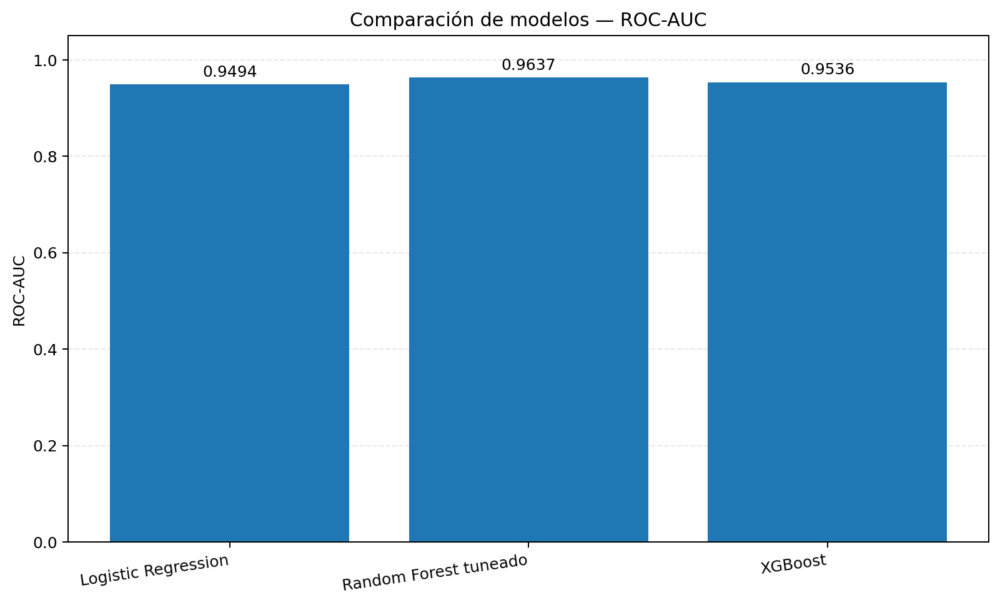
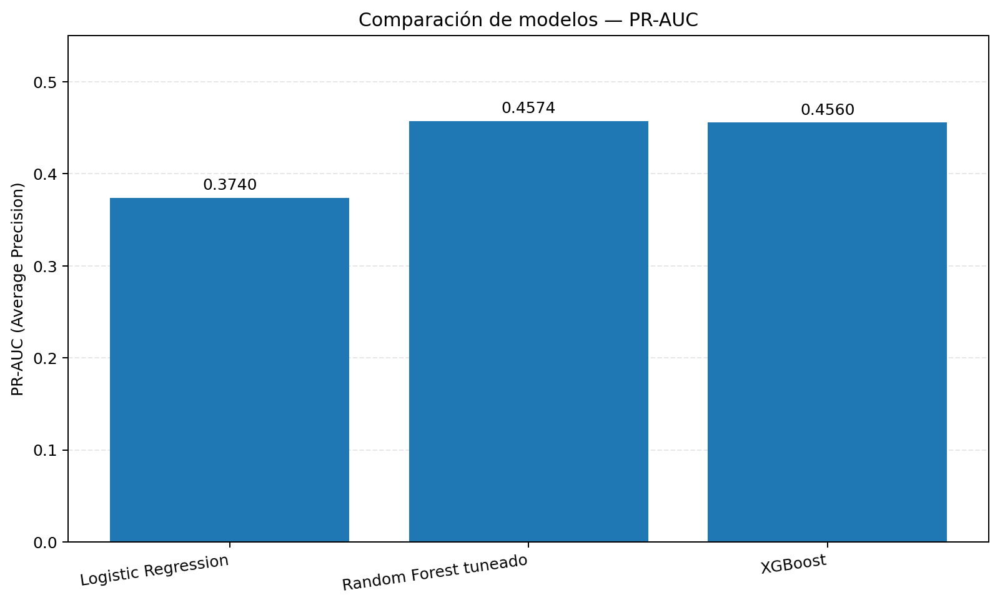
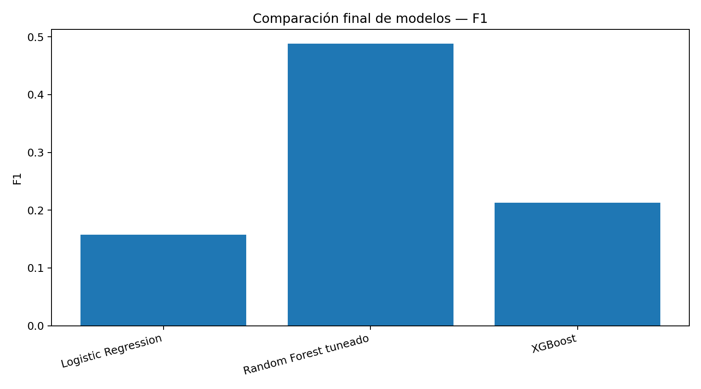

# Clasificación de vehículos DNRPA

Proyecto de Machine Learning para clasificar registros de automotores en `Privado` y `No_Privado`, con énfasis en la detección de la clase minoritaria.

## Datos

El análisis documentado utiliza 62.310 registros de vehículos con año-modelo desde 2016 y 19 variables predictoras. La clase `No_Privado` representa aproximadamente el 0,41 % de los registros. Los datos originales no se incluyen en este repositorio. Consulta [`data/README.md`](data/README.md).

## Resultados principales

Precision, Recall y F1 se reportan para la clase positiva `No_Privado`. PR-AUC se presenta como Average Precision.

| Modelo | Precision | Recall | F1 | ROC-AUC | PR-AUC |
|---|---:|---:|---:|---:|---:|
| Regresión logística | 0,0882 | 0,7451 | 0,1577 | 0,9494 | 0,3740 |
| Random Forest tuneado | 0,6000 | 0,4118 | 0,4884 | 0,9637 | 0,4574 |
| XGBoost | 0,1269 | 0,6667 | 0,2132 | 0,9536 | 0,4560 |

El modelo principal es el Random Forest tuneado, con umbral operativo de `0.31`, seleccionado mediante probabilidades Out-of-Fold sobre entrenamiento.

**Nota metodológica:** el análisis detallado de errores, ablación, SHAP y parte del análisis por año-modelo utilizan un Random Forest de referencia con umbral `0.35`. No deben atribuirse como resultados específicos del modelo tuneado.

### ROC-AUC

### PR-AUC

### F1

## Estructura

- `notebooks/`: notebook de análisis principal.
- `data/`: instrucciones; los datos no se distribuyen.
- `src/`: módulos auxiliares disponibles en el repositorio.
- `results/`: métricas, ablación, errores, evaluación temporal y SHAP exportados.
- `figures/`: gráficos del análisis.
- `docs/`: metodología y conclusiones.
- `models/`: política de artefactos.

## Reproducibilidad

1. Obtén los datos por una vía autorizada y sigue `data/README.md`.
2. Instala las dependencias de `requirements.txt`.
3. Ejecuta las celdas del notebook en orden en un entorno compatible.
4. Para consultar las tablas y figuras ya exportadas no hace falta reentrenar los modelos ni recalcular SHAP.

## Limitaciones

- El desbalance entre clases es extremo; Precision, Recall y F1 dependen del umbral.
- La prueba temporal por año-modelo contiene solo ocho positivos `No_Privado`, por lo que sus métricas tienen alta incertidumbre.
- La división por año-modelo no equivale necesariamente a una validación cronológica estricta por fecha del trámite.
- Los resultados predictivos no demuestran causalidad.
- Antes de redistribuir datos o artefactos, verifica las condiciones de uso y privacidad de la fuente.

